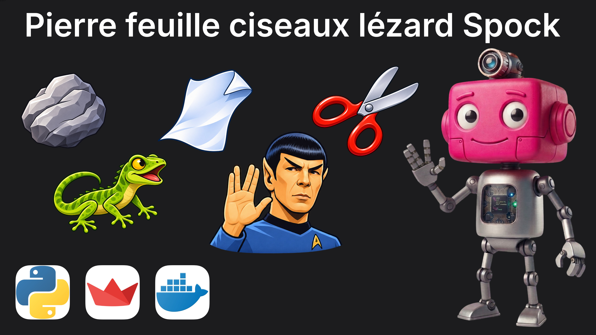
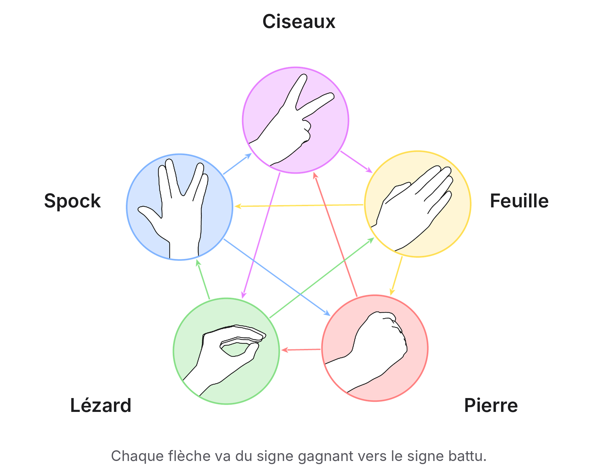

# Chifoumy

  

Application Streamlit : une partie de pierre-feuille-ciseaux-lézard-Spock
contre la machine. La webcam photographie la main, un modèle de machine
learning reconnaît le geste, la machine joue au hasard. Le premier à
3 points gagne la partie.

- **Démo en ligne :** https://chifoumy.bejian.fr
- **Page du projet dans mon portfolio :** https://www.bejian.fr/project/chifoumy
- **Portfolio :** https://www.bejian.fr

## Le jeu

Pierre-feuille-ciseaux-lézard-Spock est une version étendue du
chifoumi, popularisée par la série « The Big Bang Theory » :
[Sheldon Cooper en explique les règles](https://www.youtube.com/watch?v=jnfz_9d9BUA).
Chaque geste en bat deux et perd contre deux.

  

## Fonctionnement

- `app/include.py` : la reconnaissance de la main.
  - MediaPipe repère 21 points sur la main (poignet, articulations,
    bouts des doigts) ;
  - la photo devient ainsi 63 nombres : x, y et z pour chaque point.
- `app/app.py` : l'interface Streamlit.
  - mise à l'échelle des 63 nombres, puis prédiction du geste par un
    classifieur SVC de scikit-learn (dossier `models/`) ;
  - tirage au hasard du geste de la machine, application des règles
    et calcul des scores, propres à chaque joueur.

Projet de fin de bootcamp Data Science au Wagon, mené en équipe,
remis en état pour ce portfolio.

## Lancer en local

Python 3.12 est obligatoire : la version de MediaPipe utilisée ne
fonctionne pas avec Python 3.13.

    uv venv --python 3.12
    source .venv/bin/activate
    uv pip install -r requirements.txt
    streamlit run app/app.py

## Lancer avec Docker

    docker build -t chifoumy .
    docker run -p 8501:8501 chifoumy

Puis ouvrir http://localhost:8501 (le navigateur demande l'accès à la
webcam).

## Déploiement

Image Docker sur un VPS, derrière un reverse proxy Caddy (HTTPS automatique).

## Stack

Python 3.12 · MediaPipe · scikit-learn · Streamlit · uv · Docker · Caddy

---

Pierre BÉJIAN · [bejian.fr](https://bejian.fr)
